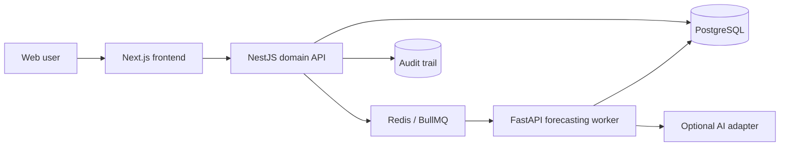

# SupplyPilot

**Inventory intelligence for multi-location merchants.** SupplyPilot shows which stockouts come from late suppliers, which purchase orders are delayed, and what a proposed reorder would do to inventory and cash, with the numbers behind every recommendation.

> **Status:** early development. The project is being built over a 6-week roadmap (see below). It uses only synthetic data and local mocks.

## The problem

Merchants that run more than one warehouse struggle to answer basic questions:

- Was this stockout caused by demand, or by a supplier that delivered late?
- Which purchase orders are delayed, and by how much?
- If I reorder now, what happens to stock levels and cash next month?

SupplyPilot puts stock movements, supplier lead times and purchase orders in one place and answers these questions with deterministic calculations. AI can explain those calculations but never replaces them.

## Who it's for

- **Inventory planners:** monitor stock and run demand scenarios
- **Purchasing managers:** review reorder proposals and approve purchase orders
- **Warehouse operators:** receive shipments, including partial ones
- **Administrators:** manage organizations, warehouses and permissions

## Demo workflow

1. Import synthetic SKUs and supplier lead times
2. Reconcile warehouse balances
3. Simulate a demand spike
4. Review reorder recommendations with numerical evidence
5. Approve a purchase order
6. Receive a partial shipment
7. Inspect the audit trail

## Planned features

- Organization and warehouse permissions
- SKU catalog, units and stock movements
- CSV import with field mapping and deduplication
- Supplier profiles and lead-time history
- Purchase orders, approvals and receipts
- Deterministic reorder-point calculator
- Demand scenario sandbox
- AI explanations of reorder recommendations that cite the actual calculations
- Alerts and exceptions dashboard
- Inventory audit trail and exports

## Tech stack

| Layer | Technology |
|---|---|
| Frontend | Next.js, TypeScript |
| API | NestJS |
| Forecasting worker | Python, FastAPI |
| Database | PostgreSQL |
| Queue and cache | Redis, BullMQ |
| Local environment | Docker Compose |
| CI | GitHub Actions |

## Architecture

The system starts as a modular monolith for transactional writes. Slow work such as imports, forecasting and AI explanations runs in background jobs. PostgreSQL is the single source of truth; caches are never authoritative.



### Planned repository layout

```text
supplypilot/
├── apps/web/              # Next.js frontend
├── services/api/          # NestJS domain API
├── services/worker/       # FastAPI forecasting worker
├── packages/contracts/    # OpenAPI contracts and generated clients
├── packages/fixtures/     # synthetic demo data
├── infra/compose/         # local services
├── tests/                 # integration and end-to-end tests
└── docs/                  # architecture decisions and progress notes
```

## Design rules

- Stock movements are append-only; corrections use compensating events.
- Receiving the same shipment twice never increases stock twice.
- Reorder proposals never become purchase orders without human approval.
- AI output is a draft that must cite real calculations; it never acts on its own.
- Every business action is authorized on the server, not just in the UI.
- Retries are safe through idempotency keys and unique constraints.

## Roadmap

| Week | Focus | Status |
|---|---|---|
| Week 1 | **Foundation** — Add pnpm monorepo skeleton and Compose stack for PostgreSQL and Redis, add deterministic synthetic supply chain generator with tests | ✅ Done |
| Week 2 | **Tenancy & catalog** — Bootstrap NestJS API with health endpoint and migrations, add organizations, memberships and role guard, add SKU, warehouse and supplier models, add catalog endpoints with validation and error envelope | ✅ Done |
| Week 3 | **Stock ledger & CSV import** — Add append-only inventory events and movement endpoint, project stock balances and expose GET /v1/inventory, add CSV upload, column mapping and preview, deduplicate rows and apply imports as movements in a job | ✅ Done |
| Week 4 | **Purchasing & receiving** — Add purchase orders and lines, add approval state machine with audit events, record receipts including partial shipments, add purchase order list, approval and receiving screens | ✅ Done |
| Week 5 | **Reorder & scenarios** — Bootstrap FastAPI worker with lead-time statistics, add reorder-point calculator with unit tests, add reorder proposals and decision endpoint, add demand scenario sandbox with versioned snapshots, show reorder evidence and scenario results | Planned |
| Week 6 | **AI explanations & release** — Add explanation adapter with mock model and citation checks, cover invalid output, prompt injection and cross-tenant evidence, add lint, typecheck, test and migration checks, add setup guide, demo script and progress notes | Planned |

## Documentation

- [Architecture decisions](docs/adr/README.md)
- [Week 01 acceptance cases](docs/acceptance/week-01-monorepo-and-fixtures.md)
- [Progress notes](docs/progress/week-01.md)

## Getting started

Full setup instructions will be added once the first services are in place. What exists today:

```bash
cp .env.example .env
pnpm services:up        # PostgreSQL and Redis via Docker Compose
pnpm fixtures           # generate synthetic data into .fixtures/ (needs Python 3.11+)
pnpm test:fixtures      # run the fixture generator's tests
pnpm api:dev            # API on :3001 (see apps/api/README.md)
pnpm web:dev            # web app on :3000 (see apps/web/README.md)
```
